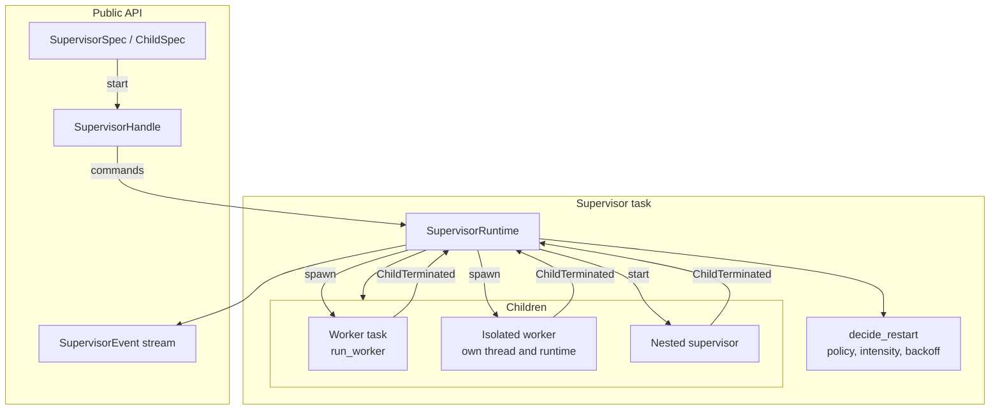
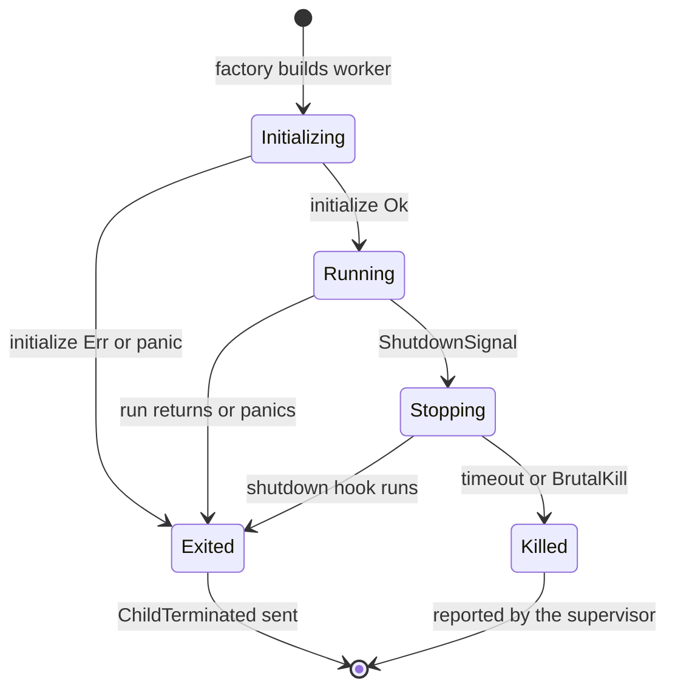
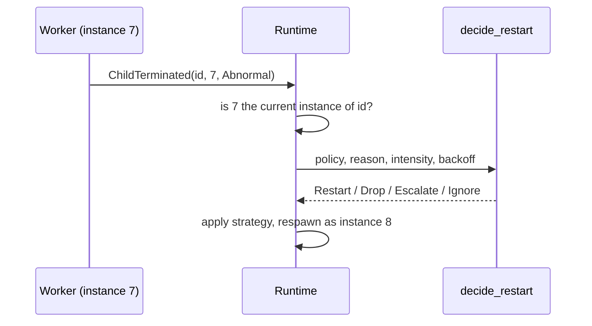
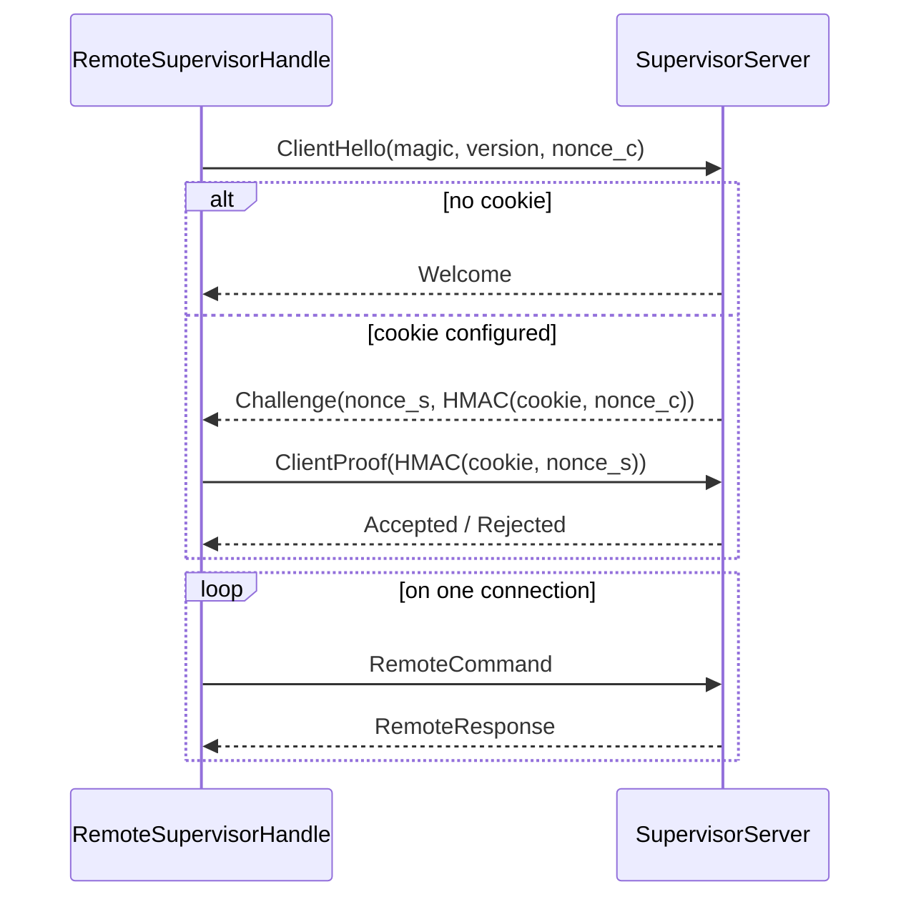

# Architecture

## Overview

A supervisor is a single tokio task, the runtime, that owns its children and processes one command at a
time from an unbounded channel. Handles, workers and nested supervisors all talk to it through that
channel, so supervision state is never shared or locked.

## Modules

| Module | Responsibility |
|---|---|
| `worker` | `Worker` trait, type erasure, `WorkerProcess`, isolated execution |
| `supervisor` | Spec, handle, runtime, child bookkeeping, errors |
| `supervisor_common` | Restart decisions and the worker lifecycle |
| `restart` | Strategies, policies, intensity and backoff tracking |
| `events` | `SupervisorEvent`, child instance numbers |
| `link` | Links between children |
| `panic` | Turning panics into abnormal exits |
| `stall` | Poll timing and the stall watchdog |
| `mailbox` | Typed mailboxes, call/cast |
| `registry` | Name registry |
| `distributed` | Remote control protocol, handshake and authentication |
| `python` | Python bindings (`python` feature) |

## Worker lifecycle

Every call into user code is wrapped so a panic becomes an error. `initialize`, `run` and `shutdown`
run on the worker's task; the factory runs on the supervisor's task, and a panic there fails only that
child's start.

## Exit handling

Each started child gets a unique instance number, carried by its exit report. The runtime acts only on
reports about the current instance of a child; reports about an instance it has already stopped or
replaced are recognised as stale. This keeps two failures that arrive together from triggering two
restart rounds.

Every termination is reported exactly once: a child that exits on its own reports itself; a child
the supervisor stops is reported by the supervisor, which then silences the child's own report; a
killed child sends no report.

## Shutdown

Children stopped together, on supervisor shutdown or a `OneForAll` / `RestForOne` restart, are stopped
in reverse start order by default, or all at once with `ShutdownOrder::Concurrent`. Each worker is
sent its `ShutdownSignal` and given its own `Shutdown` setting; nested supervisors stop their own
children first. `SupervisorHandle::shutdown` returns once the whole tree has stopped.

## Remote control

Frames are length-prefixed rkyv archives, validated before use and capped at 10 MB. A server on a
different protocol version answers `Unsupported`. A client handle keeps its connection open and
retries once on a fresh connection if the old one was closed before any reply arrived.

## Mailboxes

A mailbox is a tokio channel whose receiving end is shared behind a mutex. Clones of a `Mailbox` read
from the same queue, so a worker's factory can hand the same mailbox to every instance it builds, and
several workers can share one mailbox as a pool. `MailboxHandle::call` sends a message carrying a
oneshot `Reply` and waits for the answer.
