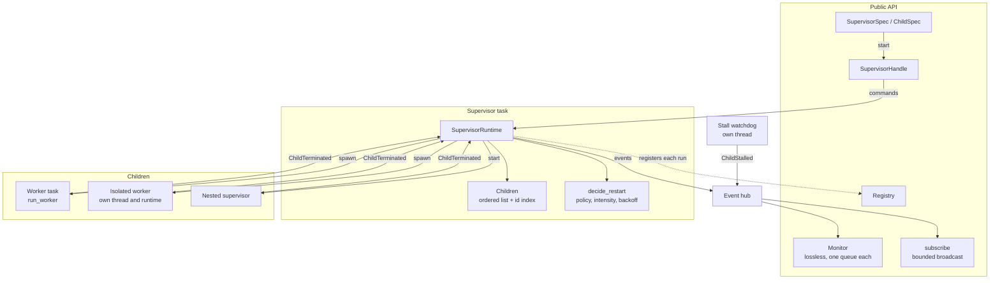
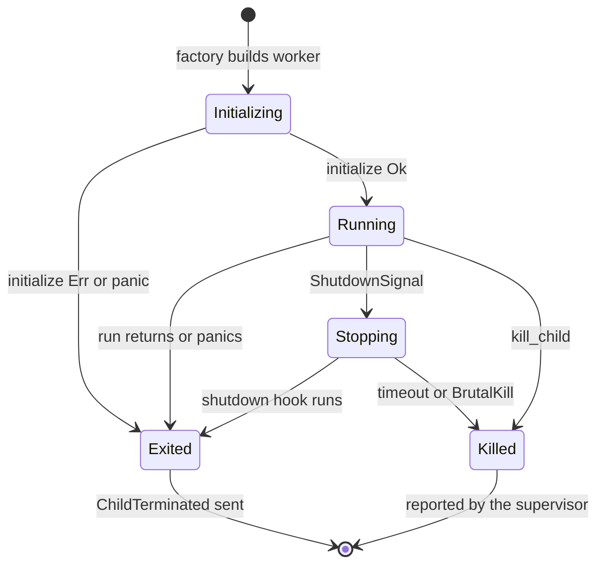
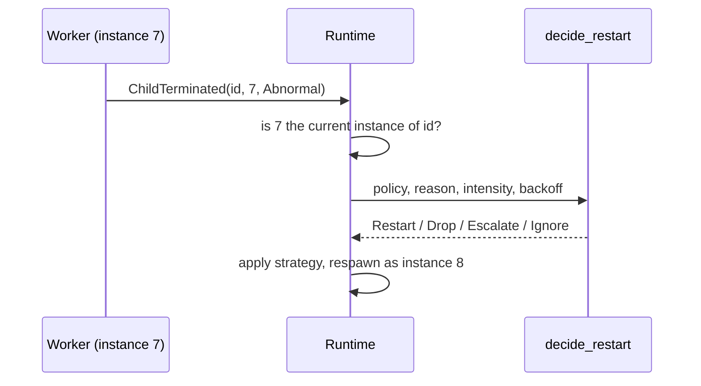
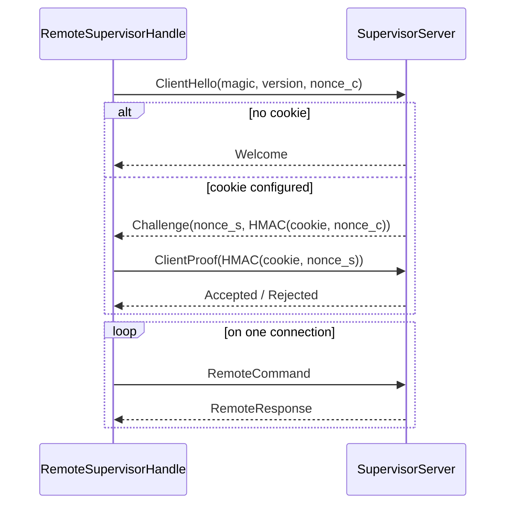

# Architecture

## Overview

A supervisor is a single tokio task, the runtime, that owns its children and processes one command at a
time from an unbounded channel. Handles, workers and nested supervisors all talk to it through that
channel, so supervision state is never shared or locked. The one piece of shared state is the
supervisor's event hub, which the runtime, its handles and the stall watchdog all emit to.

## Modules

| Module | Responsibility |
|---|---|
| `worker` | `Worker` trait, type erasure, `WorkerProcess`, isolated execution |
| `types` | `ChildExitReason`, `ChildInfo`, `ShutdownSignal`, `WorkerContext` |
| `supervisor` | Spec, handle, runtime, child bookkeeping, errors |
| `supervisor_common` | Restart decisions and the worker lifecycle |
| `restart` | Strategies, policies, intensity and backoff tracking |
| `events` | `SupervisorEvent`, lossless `Monitor`s and the lossy broadcast, child instance numbers |
| `link` | Links between children |
| `panic` | Turning panics into abnormal exits |
| `stall` | Poll timing and the stall watchdog |
| `mailbox` | Typed mailboxes, call/cast |
| `registry` | Name registry |
| `distributed` | Remote control protocol, handshake and authentication |
| `macros` | `supervision_tree!`, `impl_worker!` and the remote-control macros |
| `python` | Python bindings (`python` feature) |

## Worker lifecycle

Every call into user code is wrapped so a panic becomes an error. `initialize`, `run` and `shutdown`
run on the worker's task; the factory runs on the supervisor's task, and a panic there fails only that
child's start.

## Exit handling

Each started child gets a unique instance number, carried by its exit report. The runtime acts only on
reports about the current instance of a child; reports about an instance it has already stopped or
replaced are recognised as stale. This keeps two failures that arrive together from triggering two
restart rounds.

Every termination is reported exactly once: a child that exits on its own reports itself; a child
the supervisor stops is reported by the supervisor, which then silences the child's own report; a
killed child sends no report.

The runtime serves one command at a time, and some commands wait inline: stopping a child (for
`terminate_child`, a `OneForAll` or `RestForOne` restart round, or shutdown) and starting one with
`start_child_linked`. Until they finish, every other command, including `kill_child` and
`which_children`, queues behind them. A child with a long `Shutdown::Infinity` cleanup therefore
delays every caller of its supervisor for that long.

## Events, monitors and links

Each supervisor has an event hub. Every emitted event goes to:

- each `Monitor`, through its own unbounded queue, so none is ever missed; a monitor of one child
  receives only that child's events and `Stopped`. Monitors end after `Stopped`, and one created after
  the supervisor stopped ends at once;
- the `subscribe` broadcast, which holds about a thousand events per receiver and drops the oldest
  for a receiver that falls behind.

Monitors are fed under a lock, so each sees events in the order they were emitted, even when the stall
watchdog emits from its own thread. A monitor nobody reads grows without bound; dropping it removes
its queue.

A link is a task holding a child monitor on each end. When either child ends other than normally, it
kills the other with `kill_child` and remembers that kill, so the resulting termination is not sent
back across the link. Because each end is a monitor, a link that is busy, for example waiting for a
slow supervisor to answer, still sees every later termination. The task ends when the `Link` is
dropped or both supervisors have stopped.

## Escalation

A supervisor that exceeds its restart intensity stops its children and exits `Abnormal`. A nested one
reports that to its parent, which applies the nested supervisor's restart policy; one that stopped
itself through `AutoShutdown` exits `Normal`. A top-level supervisor has no parent: `wait()` resolves
with the reason, and `GiveUp::ExitProcess` exits the process once the tree is down. A supervisor with
a registered name registers each run before starting its children and unregisters when the run ends.

## Shutdown

Children stopped together, on supervisor shutdown or a `OneForAll` / `RestForOne` restart, are stopped
in reverse start order by default, or all at once with `ShutdownOrder::Concurrent`. Each worker is
sent its `ShutdownSignal` and given its own `Shutdown` setting, the supervisor's shutdown timeout
unless it sets one; in reverse order those timeouts add up. A nested supervisor is waited for, with no
timeout of its own, until it has stopped its children the same way. `SupervisorHandle::shutdown`
returns once the whole tree has stopped.

## Blocking work

A worker's `run` future is dropped at its next await point when the worker is stopped or killed; a
worker that never awaits cannot be stopped this way.

With stall detection on, each poll of a worker is timed. A watchdog thread checks every 10 ms and
emits `ChildStalled` once per stall for a worker that has been inside one poll for longer than the
threshold, while it is still stuck.

An isolated worker runs on a thread of its own with a single-threaded runtime. On the shared runtime a
stand-in future represents it: the stand-in ends when the worker does, and dropping it tells the
worker's runtime to drop the worker's future. A worker stuck in a loop that never awaits keeps its
thread; the supervisor reports it killed and starts its replacement while the old thread runs on.

## Remote control

Frames are length-prefixed rkyv archives, validated before use and capped at 10 MB. A server on a
different protocol version answers `Unsupported`. A client handle keeps its connection open and
retries once on a fresh connection if the old one was closed before any reply arrived.

The handshake proves that both ends know the cookie, with HMAC-SHA256 over random nonces; the cookie
itself is never sent. After the handshake, frames are neither encrypted nor integrity-protected, and
a client that knows the cookie may run any command. The server handles each connection on a task of
its own and does not limit how many it accepts.

## Mailboxes

A mailbox is a tokio channel whose receiving end is shared behind a mutex. Clones of a `Mailbox` read
from the same queue, so a worker's factory can hand the same mailbox to every instance it builds, and
several workers can share one mailbox as a pool. `MailboxHandle::call` sends a message carrying a
oneshot `Reply` and waits for the answer.

## Python bindings

Python workers are callables. Each one runs on a dedicated OS thread, not tokio's blocking pool, so
the number of workers is not capped, and the GIL is released while Rust waits. A running Python call
cannot be interrupted: the worker is told to stop through its `should_stop` flag, and its `shutdown`
waits for the call to return, within its `Shutdown` setting. A call that ignores the flag past that is
abandoned and reported killed, and its thread runs on until the call returns. `subscribe()` in Python
is backed by a `Monitor`.
